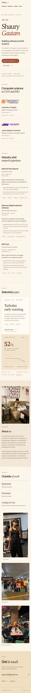
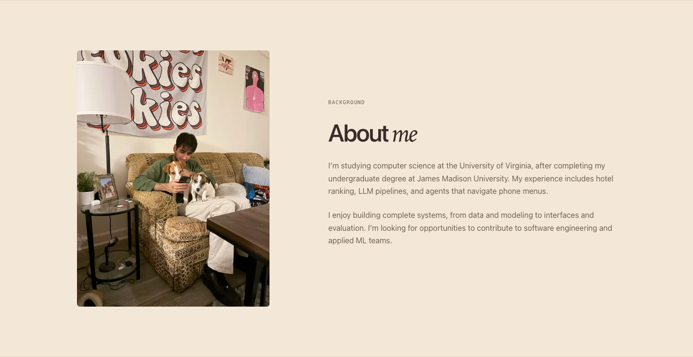
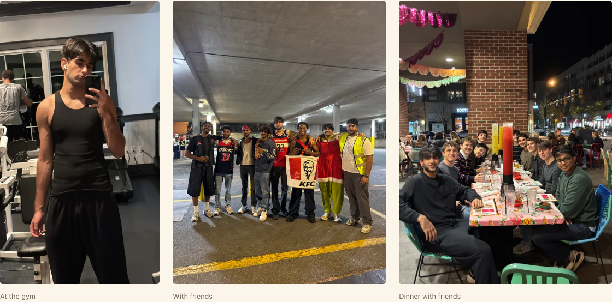

# Verification report

Validated November 15, 2026 against the production build for the four-photo update and removal of humorous copy. The terracotta/cream palette, university logos, and résumé section order are retained.

## Automated checks

- Astro diagnostics: 0 errors, 0 warnings, 0 hints.
- Vitest: all 8 tests passed across 2 files.
- Root and `/portfolio/` builds: 3 pages generated, internal links and assets verified.
- All four supplied photos are included, with two responsive WebP sizes each. Orientation is corrected, full frames are preserved, and published files contain no EXIF/XMP metadata.
- Previous humorous phrases and asides are absent from the homepage.

## Lighthouse mobile

| Page | Date | Performance | Accessibility | Best practices | SEO |
| --- | --- | ---: | ---: | ---: | ---: |
| Homepage | November 15, 2026 | 100 | 100 | 100 | 100 |
| NASA case study (previous measurement) | September 17, 2026 | 100 | 100 | 100 | 100 |

Measured against the local production preview in headless Chrome. Scores can vary with hosting conditions. Raw reports are in `verification/`.

## Browser checks

- Homepage, NASA case study, and 404 checked at 375, 768, and 1440 pixels, with no horizontal overflow or JavaScript errors.
- All four photos load at each viewport width. About and gallery layouts were visually inspected on desktop and mobile.
- Education remains before Experience and Projects. The optional boredom link remains hidden.
- Keyboard skip navigation and reduced motion work.
- NASA demo confirmed warning, reset/first-cycle boundary, engine selection/end boundary, and no-JavaScript 176-row table checks passed.
- Current photo and copy checks are recorded in `verification/photo-checks.json`. The earlier, broader demo check record is retained in `verification/browser-checks.json`.

## Screenshots

## Deployment

Repository: https://github.com/shaury04/shaury04.github.io

Production: https://shaury04.github.io/

Pushes to `main` validate and deploy through GitHub Actions. See [deployment history](https://github.com/shaury04/shaury04.github.io/actions) for current status.
