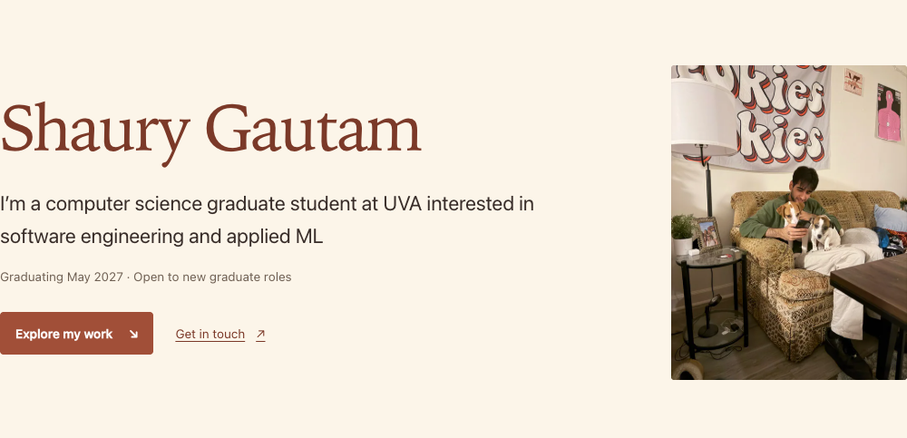
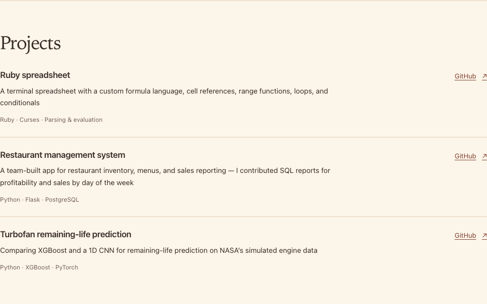
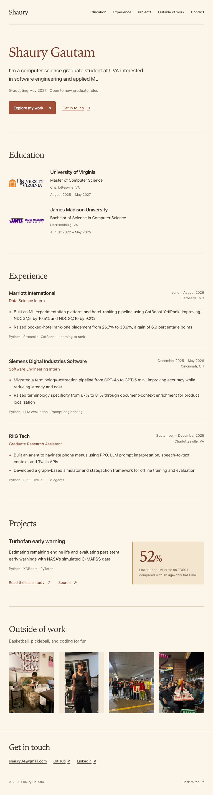

# Verification report

## Latest content update

The project list now contains exactly two entries: Turbofan first, Ruby spreadsheet second. ROMS is removed. Astro checks, all 8 unit tests, and root/prefixed builds pass; the generated homepage was checked for the exact project order and absence of ROMS. The visual checks, screenshots, and Lighthouse results below describe the preceding layout update; styling is unchanged.

## Previous layout verification

Validated November 16, 2026 after adding the Ruby spreadsheet and ROMS entries, shortening Turbofan, and moving the dog photo beside the introduction.

## Automated checks

- Astro diagnostics: 0 errors, 0 warnings, 0 hints.
- Vitest: all 8 existing tests passed across 2 files.
- Root and `/portfolio/` builds: homepage, 404, and legacy redirect generated; internal links and assets verified.
- Build checks enforce the base-aware redirect from `/work/turbofan/` to `/#work` and reject published NASA demo markup.
- No PDFs are included. The résumé link remains absent until the cleaned PDF is supplied.

## Lighthouse mobile

| Page | Date | Performance | Accessibility | Best practices | SEO |
| --- | --- | ---: | ---: | ---: | ---: |
| Homepage | November 16, 2026 | 99 | 100 | 100 | 100 |

Measured against the local production preview in headless Chrome. Scores can vary with hosting conditions. `lighthouse-home.json` and `lighthouse-summary.json` contain the current results. The retained case-study report and case/demo screenshots are historical; that page is no longer published.

## Browser checks

- Homepage and 404 checked at 375, 768, and 1440 pixels without horizontal overflow or JavaScript errors.
- The dog photo appears once: right of the introduction on desktop/tablet, below it on mobile. All four personal photos decode and preserve their complete frames.
- Education, experience, and section order remain unchanged. Three concise projects link directly to their public GitHub repositories.
- Both JavaScript-enabled and JavaScript-disabled browsers follow the old Turbofan URL to the homepage Projects section.
- Keyboard skip navigation and reduced motion pass. Lighthouse accessibility checks, including contrast, pass.
- Project descriptions were verified against public repository source. ROMS is identified as a team project, with only explicitly attributed SQL work claimed as Shaury’s contribution. Linked applications were not executed or certified as production-ready.
- Current browser results are in `verification/browser-checks.json`.

## Screenshots

## Deployment

Repository: https://github.com/shaury04/shaury04.github.io

Production: https://shaury04.github.io/

Pushes to `main` validate and deploy through GitHub Actions. See [deployment history](https://github.com/shaury04/shaury04.github.io/actions) for current status.
