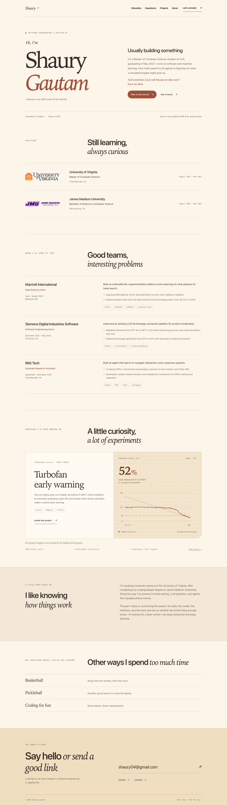
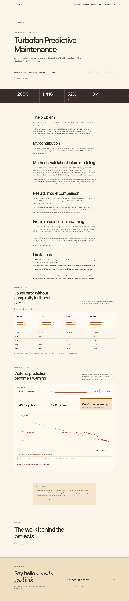
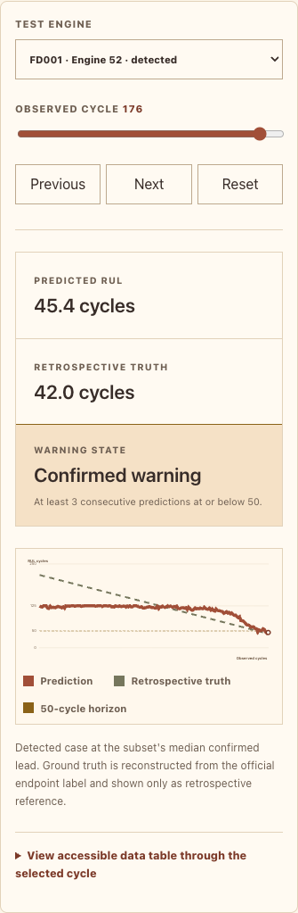

# Verification report

Validated September 17, 2026 against the production build. Screenshots and measurements below were regenerated for the warmer, more personal redesign: terracotta and amber accents, soft cream backgrounds, university logos, résumé section order, and the retained light humor.

## Automated checks

- Astro diagnostics: 0 errors, 0 warnings, 0 hints.
- Vitest: all 8 tests passed across 2 files.
- Root and `/portfolio/` builds: 3 pages generated, internal links and assets verified.
- Privacy: no PDF or phone number in site source, public assets, or production output. Removed Marriott route and résumé links are rejected by the build check.
- NASA repository is public. README results match the displayed endpoint metrics and persistent-warning results. Grouped selection wording was corrected to specify FD001 selection followed by fixed hyperparameters across subsets.

## Lighthouse mobile

| Page | Performance | Accessibility | Best practices | SEO |
| --- | ---: | ---: | ---: | ---: |
| Homepage | 100 | 100 | 100 | 100 |
| NASA case study | 100 | 100 | 100 | 100 |

Measured using Lighthouse against the local production preview in headless Chrome. Scores are local measurements and can vary with hosting conditions. Raw reports and summary are in `verification/`.

## Browser checks

- Homepage, NASA case study, and 404 inspected at widths of 375, 768, and 1440 pixels; no horizontal page overflow or JavaScript errors.
- Keyboard skip link focuses main content; section anchors exist; reduced-motion preference disables smooth scrolling.
- Demo checks cover confirmed, pending, and missed outcomes, engine selection, reset, previous/next boundary states, and slider changes. Table records are limited to the selected cycle.
- With JavaScript disabled, the narrative, initial chart, and 176-row table remain available; inactive controls are disabled and a snapshot explanation is shown.
- Desktop/mobile homepage, case-study, and demo screenshots visually reviewed.
- Education appears before Experience and Projects. Both official university logos load correctly, with UVA before JMU; the navigation follows the same order.

## Screenshots

## Deployment

GitHub repository: https://github.com/shaury04/shaury04.github.io

Production target: https://shaury04.github.io/

The first build and deployment succeeded on September 17, 2026. Subsequent pushes to `main` run the same validation and deployment workflow. See [deployment history](https://github.com/shaury04/shaury04.github.io/actions) for current status.

The optional boredom link is intentionally hidden until its destination is supplied.
